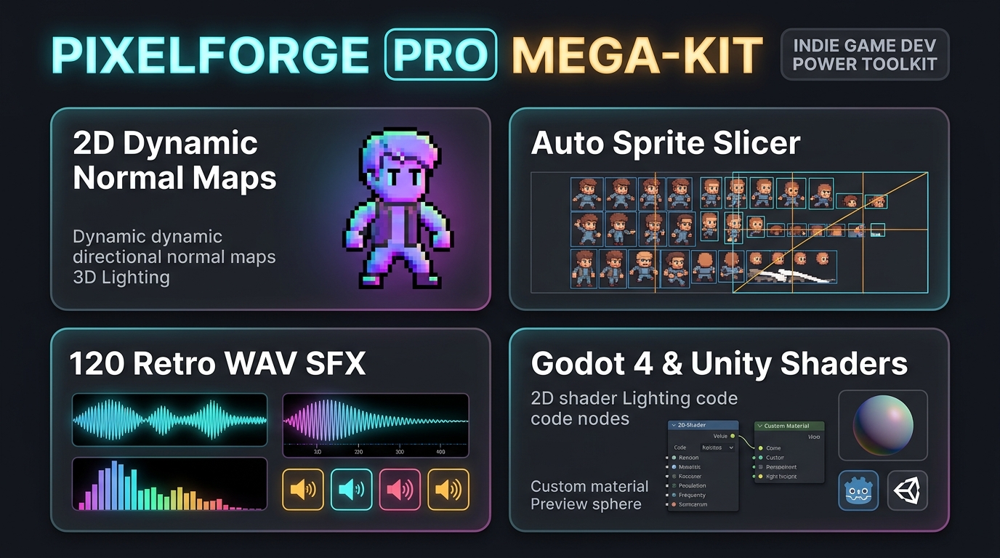

# ⚡ PixelForge Studio — 2D Normal Map Lab, Auto Sprite Slicer & Retro WAV Synth

**PixelForge Studio** is a zero-install browser & offline 2D indie game asset pipeline for **Godot 4, Unity, Unreal Paper2D, Phaser 3, and GameMaker** developers.

👉 **[Launch Free Interactive Studio in Your Browser](https://choikim0108.github.io/text-elo-lab/pixelforge/)**

---

## 🛠️ Built-In Workspaces
- **💡 2D Tangent Normal Map & Dynamic Light Lab**: Drop any pixel sprite to compute Sobel tangent normal maps with real-time 3D Blinn-Phong point lighting right on HTML5 Canvas.
- **✂️ Flood-Fill Auto Sprite Sheet Slicer**: Automatically detect irregular alpha sprite islands or slice grids and export JSON atlases for **Godot 4, Unity, and Phaser 3**.
- **🔊 Procedural 44.1kHz 16-bit PCM `.WAV` Retro SFX Synthesizer**: Instant browser synthesis + oscilloscope + clean WAV download.
- **🎨 1px Pixel Outline & Palette Quantizer**: PICO-8, GameBoy DMG, Cyberpunk Neon & custom outlines.

---

## 📦 Unlock the Commercial Pro Mega-Kit (`$1.99` Instant PayPal)
Want **120 pre-crafted CC0 44.1kHz 16-bit `.WAV` game sound effects** (Coins, Jumps, Lasers, Explosions, Damage Hits, Power-Ups, UI, Synths) + **6 Production 2D Shaders for Godot 4 & Unity** (Hit Flash, 8-Dir Pixel Outline, Ember Burn Dissolve, CRT Scanline)?

👉 **[Click Here to Grab the Pro Mega-Kit via PayPal ($1.99 USD)](https://www.paypal.com/cgi-bin/webscr?cmd=_xclick&business=judasx0108%40gmail.com&item_name=PixelForge+Pro+MegaKit+%28120+WAV+SFX+%2B+6+Godot%2FUnity+2D+Shaders%29&amount=1.99&currency_code=USD&no_shipping=1)**
